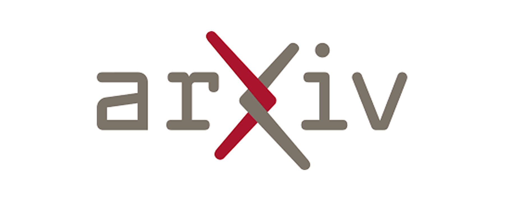

# 📰 AI & CG 每日资讯 - 2026-10-29

> 自动生成于 2026-10-29 11:00:32

## 🔥 GitHub Trending

["开源项目"]

GitHub

<a href="https://github.com/HKUDS/DeepTutor" target="_blank" class="news-title-link">
<h3 class="news-title">DeepTutor</h3>
</a>

[EN] DeepTutor: Lifelong Personalized Tutoring.

        
开源项目

🔤 Python
⭐ +2371

["开源项目"]

GitHub

<a href="https://github.com/elayadesign/ai-design-skills" target="_blank" class="news-title-link">
<h3 class="news-title">ai-design-skills</h3>
</a>

        
开源项目

🔤 Unknown
⭐ +2139

["大语言模型", "开源项目"]

GitHub

<a href="https://github.com/Nutlope/hallmark" target="_blank" class="news-title-link">
<h3 class="news-title">hallmark</h3>
</a>

[EN] Anti-AI-slop design skill for Claude Code, Cursor, a...

        
大语言模型 开源项目

🔤 CSS
⭐ +2110

["开源项目"]

GitHub

<a href="https://github.com/hmjz100/LinkSwift" target="_blank" class="news-title-link">
<h3 class="news-title">LinkSwift</h3>
</a>

[EN] 一个基于 JavaScript 的网盘文件下载地址获取工具。基于【网盘直链下载助手】修改 ，支持 百度网...

        
开源项目

🔤 JavaScript
⭐ +1616

["开源项目"]

GitHub

<a href="https://github.com/togg53192-cmd/jailbreaks" target="_blank" class="news-title-link">
<h3 class="news-title">jailbreaks</h3>
</a>

[EN] LIST OF ALL MY JAILBREAKS

        
开源项目

🔤 Unknown
⭐ +1477

["开源项目"]

GitHub

<a href="https://github.com/pbakaus/impeccable" target="_blank" class="news-title-link">
<h3 class="news-title">impeccable</h3>
</a>

[EN] The design vocabulary for your coding agent. Steer w...

        
开源项目

🔤 Rust
⭐ +1472

["开源项目"]

GitHub

<a href="https://github.com/obra/superpowers" target="_blank" class="news-title-link">
<h3 class="news-title">superpowers</h3>
</a>

[EN] An agentic skills framework & software development m...

        
开源项目

🔤 Shell
⭐ +1095

["开源项目"]

GitHub

<a href="https://github.com/JetBrains/thinkrail" target="_blank" class="news-title-link">
<h3 class="news-title">thinkrail</h3>
</a>

[EN] Vibe code with pi in a lightweight, real IDE that cu...

        
开源项目

🔤 TypeScript
⭐ +1068

["大语言模型", "开源项目"]

GitHub

<a href="https://github.com/nightly-labs/openbot" target="_blank" class="news-title-link">
<h3 class="news-title">openbot</h3>
</a>

[EN] A local-first desktop workspace for persistent AI te...

        
大语言模型 开源项目

🔤 TypeScript
⭐ +1054

["开源项目"]

GitHub

<a href="https://github.com/makecindy/cindy" target="_blank" class="news-title-link">
<h3 class="news-title">cindy</h3>
</a>

[EN] Consider it done. The open-source AI agent that work...

        
开源项目

🔤 TypeScript
⭐ +728

## 🤗 Hugging Face Papers

> Daily Top Papers from hf.co/papers

["图像生成", "论文/研究", "大语言模型", "机器学习"]

HuggingFace
2026-10-26T00:00:00.000Z

<a href="https://huggingface.co/papers/2610.35201" target="_blank" class="news-title-link">
<h3 class="news-title">DTCA: Denoising Token Credit Assignment for Reinforcement Learning in Diffusion Language Models</h3>
</a>

[EN] DTCA improves reinforcement learning for diffusion language models by as...

        
图像生成 论文/研究 大语言模型

📄 Paper
👍 252

["论文/研究", "机器学习"]

HuggingFace
2026-10-26T00:00:00.000Z

<a href="https://huggingface.co/papers/2610.36192" target="_blank" class="news-title-link">
<h3 class="news-title">Beyond the Estimate: Wiener-Informed Decoding for Easier Training of Pixel-Space Flow Models</h3>
</a>

[EN] Wiener-informed Decoding accelerates pixel-space velocity model training...

        
论文/研究 机器学习

📄 Paper
👍 10

["论文/研究", "机器学习"]

HuggingFace
2026-10-26T00:00:00.000Z

<a href="https://huggingface.co/papers/2610.34894" target="_blank" class="news-title-link">
<h3 class="news-title">What Outcome RL Buys: Finishing, Reliability, Rarely Reach</h3>
</a>

[EN] Reinforcement learning improves pass@1 mainly by finishing answers faste...

        
论文/研究 机器学习

📄 Paper
👍 4

["论文/研究", "机器学习"]

HuggingFace
2026-10-22T00:00:00.000Z

<a href="https://huggingface.co/papers/2610.31924" target="_blank" class="news-title-link">
<h3 class="news-title">Sub-monolayer tracking of molecular states at buried interfaces</h3>
</a>

[EN] Machine learning-enhanced optical modeling of polarized resonant soft X-...

        
论文/研究 机器学习

📄 Paper
👍 3

["论文/研究", "机器学习"]

HuggingFace
2026-10-23T00:00:00.000Z

<a href="https://huggingface.co/papers/2610.32749" target="_blank" class="news-title-link">
<h3 class="news-title">Efficient Streaming Audio-Visual Target Speaker Extraction for Real-World Acoustic Scenes</h3>
</a>

[EN] Falcon is a lightweight causal audio-visual target speaker extraction me...

        
论文/研究 机器学习

📄 Paper
👍 2

["论文/研究", "大语言模型", "机器学习"]

HuggingFace
2026-10-21T00:00:00.000Z

<a href="https://huggingface.co/papers/2610.30435" target="_blank" class="news-title-link">
<h3 class="news-title">Self-Assessment Reinforcement Learning for Search-State Awareness in Retrieval-Augmented Large Language Models</h3>
</a>

[EN] Self-Assessment Reinforcement Learning trains search agents to recognize...

        
论文/研究 大语言模型 机器学习

📄 Paper
👍 2

["论文/研究", "机器学习", "计算机视觉"]

HuggingFace
2026-10-27T00:00:00.000Z

<a href="https://huggingface.co/papers/2509.05512" target="_blank" class="news-title-link">
<h3 class="news-title">Quaternion Approximate Networks for Enhanced Image Classification and Oriented Object Detection</h3>
</a>

[EN] QUAN is a quaternion-based deep learning framework that approximates qua...

        
论文/研究 机器学习 计算机视觉

📄 Paper
👍 2

["论文/研究", "大语言模型", "机器学习", "开源项目"]

HuggingFace
2026-10-15T00:00:00.000Z

<a href="https://huggingface.co/papers/2610.22684" target="_blank" class="news-title-link">
<h3 class="news-title">AlphaBet: Reinforcement Learning for LLM Event Forecasting Agents</h3>
</a>

[EN] AlphaBet uses agentic reinforcement learning to train a single LLM polic...

        
论文/研究 大语言模型 机器学习

📄 Paper
👍 2

["论文/研究", "机器学习"]

HuggingFace
2026-10-23T00:00:00.000Z

<a href="https://huggingface.co/papers/2610.33245" target="_blank" class="news-title-link">
<h3 class="news-title">AdaPRA: Process Reward Agents with Adaptive Rubrics for Data Science</h3>
</a>

[EN] AdaPRA improves data science agents via persistent knowledge accumulatio...

        
论文/研究 机器学习

📄 Paper
👍 1

["论文/研究", "机器学习"]

HuggingFace
2026-10-26T00:00:00.000Z

<a href="https://huggingface.co/papers/2610.36184" target="_blank" class="news-title-link">
<h3 class="news-title">Lipi-Ghor: A Large-Scale, Diarized, Multi-Domain Bengali Speech Corpus and a Scalable Pipeline for Building It</h3>
</a>

[EN] Lipi-Ghor is a large-scale weakly supervised Bengali speech corpus with ...

        
论文/研究 机器学习

📄 Paper
👍 1

## 🚀 Product Hunt 每日精选

["大语言模型", "产品发布"]

ProductHunt

<a href="https://www.producthunt.com/products/hob-3" target="_blank" class="news-title-link">
<h3 class="news-title">Hob</h3>
</a>

[EN] Open-source, on device alternative to Claude and ChatGPT

        
大语言模型 产品发布

🆕 Product
▲ 0

["产品发布"]

ProductHunt

<a href="https://www.producthunt.com/products/throxy-yc-p25" target="_blank" class="news-title-link">
<h3 class="news-title">throxy</h3>
</a>

[EN] Cold calls in your prospect's language. Pipeline delivered.

        
产品发布

🆕 Product
▲ 0

["产品发布"]

ProductHunt

<a href="https://www.producthunt.com/products/gemini-1-5-pro" target="_blank" class="news-title-link">
<h3 class="news-title">Genie 4</h3>
</a>

[EN] Turn a prompt into a living world you can steer

        
产品发布

🆕 Product
▲ 0

["产品发布"]

ProductHunt

<a href="https://www.producthunt.com/products/lfm2" target="_blank" class="news-title-link">
<h3 class="news-title">LFM3 by Liquid AI</h3>
</a>

[EN] Six 2B-class models for phones, laptops and robots

        
产品发布

🆕 Product
▲ 0

["产品发布"]

ProductHunt

<a href="https://www.producthunt.com/products/zro" target="_blank" class="news-title-link">
<h3 class="news-title">Zro: Uncensored Security Models</h3>
</a>

[EN] Abliterated open models for security work

        
产品发布

🆕 Product
▲ 0

["产品发布"]

ProductHunt

<a href="https://www.producthunt.com/products/app-store-screenshots" target="_blank" class="news-title-link">
<h3 class="news-title">App Store Screenshots</h3>
</a>

[EN] Your coding agent designs your app store screenshots

        
产品发布

🆕 Product
▲ 0

["产品发布"]

ProductHunt

<a href="https://www.producthunt.com/products/tulu" target="_blank" class="news-title-link">
<h3 class="news-title">Tulu</h3>
</a>

[EN] Autonomous marketing operations & analytics for SMBs

        
产品发布

🆕 Product
▲ 0

["产品发布"]

ProductHunt

<a href="https://www.producthunt.com/products/bytemail" target="_blank" class="news-title-link">
<h3 class="news-title">bytemail</h3>
</a>

[EN] Native Mac email: every inbox, in your notch, no trackers

        
产品发布

🆕 Product
▲ 0

["产品发布"]

ProductHunt

<a href="https://www.producthunt.com/products/fraud-blocker" target="_blank" class="news-title-link">
<h3 class="news-title">Fraud Blocker</h3>
</a>

[EN] AI ad fraud protection for Google and Meta ads

        
产品发布

🆕 Product
▲ 0

["产品发布"]

ProductHunt

<a href="https://www.producthunt.com/products/dedica" target="_blank" class="news-title-link">
<h3 class="news-title">Dedica</h3>
</a>

[EN] Check if AI agents can use your website

        
产品发布

🆕 Product
▲ 0

## 🎨 CG 图形学

> 覆盖: Unreal Engine | Three.js | Blender | Houdini | Unity | Godot | NVIDIA

["Unreal Engine", "官方资讯"]

Official
Thu, 22 Oct 2026 00:00:00 GMT

<a href="https://www.unrealengine.com/news/2026-epic-ai-megajam" target="_blank" class="news-title-link">
<h3 class="news-title">Vibe your way to $50k: the 2026 Epic AI MegaJam is coming</h3>
</a>

[EN] Vibe your way to $50k: the 2026 Epic AI MegaJam is coming

        
Unreal Engine 官方资讯

🏛️ 官方 🤖 AI
🔥 100

["Blender", "开源项目", "官方资讯"]

Official
Wed, 23 Sep 2026 07:39:43 +0000

<a href="https://www.blender.org/news/blender-foundation-annual-report-2025/" target="_blank" class="news-title-link">
<h3 class="news-title">Blender Foundation Annual Report 2025</h3>
</a>

[EN] Blender Foundation Annual Report 2025

        
Blender 开源项目 官方资讯

🏛️ 官方 🤖 AI
🔥 100

["官方资讯", "Unity"]

Official
Tue, 27 Oct 2026 00:00:00 GMT

<a href="https://unity.com/blog/video-game-terrain-guide" target="_blank" class="news-title-link">
<h3 class="news-title">How does terrain work in video games?</h3>
</a>

[EN] How does terrain work in video games?

        
官方资讯 Unity

🏛️ 官方 🤖 AI
🔥 100

["官方资讯"]

Official
2026-10-27T20:50:39Z

<a href="https://developer.nvidia.com/blog/memory-enforced-gpu-sharing-in-kubernetes-with-nvidia-cuda-13-4/" target="_blank" class="news-title-link">
<h3 class="news-title">Memory-Enforced GPU Sharing in Kubernetes with NVIDIA CUDA 13.4</h3>
</a>

[EN] Memory-Enforced GPU Sharing in Kubernetes with NVIDIA CUDA 13.4

        
官方资讯

🏛️ 官方 🤖 AI
🔥 100

["官方资讯", "Unity"]

Official
Tue, 27 Oct 2026 00:00:00 GMT

<a href="https://unity.com/blog/frame-rate-in-video-games-explained" target="_blank" class="news-title-link">
<h3 class="news-title">Frame rate explained: What is fps in video games?</h3>
</a>

[EN] Frame rate explained: What is fps in video games?

        
官方资讯 Unity

🏛️ 官方 🤖 AI
🔥 100

["机器学习", "实时渲染", "官方资讯"]

Official
2026-10-27T17:00:00Z

<a href="https://developer.nvidia.com/blog/nvidia-rtx-spark-powers-neural-rendering-and-ai-characters-in-games/" target="_blank" class="news-title-link">
<h3 class="news-title">NVIDIA RTX Spark Powers Neural Rendering and AI Characters in Games</h3>
</a>

[EN] NVIDIA RTX Spark Powers Neural Rendering and AI Characters in Games

        
机器学习 实时渲染 官方资讯

🏛️ 官方 🤖 AI
🔥 100

["大语言模型", "官方资讯"]

Official
2026-10-27T16:00:00Z

<a href="https://developer.nvidia.com/blog/fine-tuning-nvidia-nemotron-to-know-local-rules-not-just-local-languages/" target="_blank" class="news-title-link">
<h3 class="news-title">Fine-Tuning NVIDIA Nemotron to Know Local Rules, Not Just Local Languages</h3>
</a>

[EN] Fine-Tuning NVIDIA Nemotron to Know Local Rules, Not Just Local Languages

        
大语言模型 官方资讯

🏛️ 官方 🤖 AI
🔥 100

["官方资讯"]

Official
2026-10-27T15:00:00Z

<a href="https://developer.nvidia.com/blog/3-ways-to-boost-moe-inference-on-nvidia-dgx-spark/" target="_blank" class="news-title-link">
<h3 class="news-title">3 Ways to Boost MoE Inference on NVIDIA DGX Spark</h3>
</a>

[EN] 3 Ways to Boost MoE Inference on NVIDIA DGX Spark

        
官方资讯

🏛️ 官方 🤖 AI
🔥 100

["官方资讯"]

Official
2026-10-26T16:00:00Z

<a href="https://developer.nvidia.com/blog/how-nvidia-minerva-turns-telemetry-chaos-into-peak-gpu-yield/" target="_blank" class="news-title-link">
<h3 class="news-title">How NVIDIA Minerva Turns Telemetry Chaos Into Peak GPU Yield</h3>
</a>

[EN] How NVIDIA Minerva Turns Telemetry Chaos Into Peak GPU Yield

        
官方资讯

🏛️ 官方 🤖 AI
🔥 100

["Three.js", "开源项目", "官方资讯"]

Official
2026-09-24T14:35:44Z

<a href="https://github.com/mrdoob/three.js/releases/tag/r186" target="_blank" class="news-title-link">
<h3 class="news-title">r186</h3>
</a>

[EN] r186

        
Three.js 开源项目 官方资讯

🏛️ 官方
🔥 50

["官方资讯"]

Official
Wed, 28 Oct 2026 12:00:00 +0000

<a href="https://godotengine.org/article/godot-xreal-aura-launch/" target="_blank" class="news-title-link">
<h3 class="news-title">Ready for XREAL AURA</h3>
</a>

[EN] Ready for XREAL AURA

        
官方资讯

🏛️ 官方
🔥 50

["Unreal Engine", "官方资讯"]

Official
Wed, 28 Oct 2026 00:00:00 GMT

<a href="https://www.unrealengine.com/learning/octobers-epic-learning-content-mobile-development-in-unreal-engine" target="_blank" class="news-title-link">
<h3 class="news-title">October’s Epic learning content: Mobile development in Unreal Engine</h3>
</a>

[EN] October’s Epic learning content: Mobile development in Unreal Engine

        
Unreal Engine 官方资讯

🏛️ 官方
🔥 50

["Unreal Engine", "官方资讯"]

Official
Tue, 27 Oct 2026 00:00:00 GMT

<a href="https://www.unrealengine.com/news/mutable-sample-for-runtime-character-customization-now-updated-for-ue-5-8" target="_blank" class="news-title-link">
<h3 class="news-title">Mutable Sample for runtime character customization—now updated for UE 5.8!</h3>
</a>

[EN] Mutable Sample for runtime character customization—now updated for UE 5.8!

        
Unreal Engine 官方资讯

🏛️ 官方
🔥 50

["Unreal Engine", "官方资讯"]

Official
Mon, 26 Oct 2026 00:00:00 GMT

<a href="https://www.unrealengine.com/developer-interviews/meccha-chameleon-how-two-devs-built-the-indie-smash-hit-of-the-summer" target="_blank" class="news-title-link">
<h3 class="news-title">Meccha Chameleon: How two devs built the indie smash hit of the summer</h3>
</a>

[EN] Meccha Chameleon: How two devs built the indie smash hit of the summer

        
Unreal Engine 官方资讯

🏛️ 官方
🔥 50

["官方资讯"]

Official
Fri, 16 Oct 2026 00:00:00 GMT

<a href="https://www.unrealengine.com/learning/check-out-the-top-fortnite-islands-from-the-uefn-student-bootcamp" target="_blank" class="news-title-link">
<h3 class="news-title">Check out the top Fortnite islands from the UEFN Student Bootcamp</h3>
</a>

[EN] Check out the top Fortnite islands from the UEFN Student Bootcamp

        
官方资讯

🏛️ 官方
🔥 50

## 💬 Hacker News 热议

["行业动态"]

HackerNews

<a href="https://surgehq.ai/blog/dayjob-tax" target="_blank" class="news-title-link">
<h3 class="news-title">Dayjob: Tax – evaluating AI agents on 50 professional tax assignments</h3>
</a>

[EN] Dayjob: Tax – evaluating AI agents on 50 professional tax assignments

        
行业动态

💬 130 评论
Points: 211

["行业动态"]

HackerNews

<a href="https://religionnews.com/2026/10/26/in-a-first-a-humanist-granted-a-religious-exemption-from-using-ai/" target="_blank" class="news-title-link">
<h3 class="news-title">Kentucky man becomes the first humanist granted religious exemption from AI</h3>
</a>

[EN] Kentucky man becomes the first humanist granted religious exemption from AI

        
行业动态

💬 487 评论
Points: 440

["大语言模型", "行业动态"]

HackerNews

<a href="https://www.brangus.io/survival-llm" target="_blank" class="news-title-link">
<h3 class="news-title">Survival LLM: AI assistant and emergency library that runs on your own computer</h3>
</a>

[EN] Survival LLM: AI assistant and emergency library that runs on your own c...

        
大语言模型 行业动态

💬 194 评论
Points: 522

["行业动态"]

HackerNews

<a href="https://www.euronews.com/video/2026/10/28/spain-first-footage-reveals-wreckage-of-deadly-high-speed-train-crash" target="_blank" class="news-title-link">
<h3 class="news-title">Two high-speed trains collide near Toledo, Spain</h3>
</a>

[EN] Two high-speed trains collide near Toledo, Spain

        
行业动态

💬 215 评论
Points: 186

["行业动态"]

HackerNews

<a href="https://tailscale.com/ssh-investigation-update" target="_blank" class="news-title-link">
<h3 class="news-title">Tailscale SSH: Investigation and remediation update</h3>
</a>

[EN] Tailscale SSH: Investigation and remediation update

        
行业动态

💬 189 评论
Points: 379

["行业动态"]

HackerNews

<a href="https://spectrum.ieee.org/wikipedia-wikiproject-ai-writing-cleanup" target="_blank" class="news-title-link">
<h3 class="news-title">Wikipedia's Cleanup of AI-Generated Content</h3>
</a>

[EN] Wikipedia's Cleanup of AI-Generated Content

        
行业动态

💬 237 评论
Points: 499

["行业动态"]

HackerNews

<a href="https://hex.tech/blog/hex-new-era/" target="_blank" class="news-title-link">
<h3 class="news-title">Hex Raises $100M</h3>
</a>

[EN] Hex Raises $100M

        
行业动态

💬 61 评论
Points: 77

["行业动态"]

HackerNews

<a href="https://www.wired.com/story/ice-is-running-one-of-the-largest-anti-left-surveillance-operations-in-us-history/" target="_blank" class="news-title-link">
<h3 class="news-title">Evidence of a spying operation by ICE against left-wing social movements</h3>
</a>

[EN] Evidence of a spying operation by ICE against left-wing social movements

        
行业动态

💬 921 评论
Points: 1104

["行业动态"]

HackerNews

<a href="https://j11g.com/the-mythical-man-month-in-the-age-of-ai" target="_blank" class="news-title-link">
<h3 class="news-title">The Mythical Man-Month in the Age of AI</h3>
</a>

[EN] The Mythical Man-Month in the Age of AI

        
行业动态

💬 353 评论
Points: 476

["行业动态"]

HackerNews

<a href="https://futurism.com/artificial-intelligence/amazon-ai-division-failure-nova" target="_blank" class="news-title-link">
<h3 class="news-title">Amazon Is Gutting Its AI Division After Sustained Failure</h3>
</a>

[EN] Amazon Is Gutting Its AI Division After Sustained Failure

        
行业动态

💬 284 评论
Points: 371

## 🎓 学术前沿 (arXiv)

["论文/研究", "NeRF/3DGS"]

arXiv
2026-10-27T15:21:01Z

<a href="https://arxiv.org/pdf/2610.37406v1" target="_blank" class="news-title-link">
<h3 class="news-title">CTBakeGS: training-free baking of photorealistic CT volume renderings into 3D Gaussian splats</h3>
</a>

[EN] CTBakeGS: training-free baking of photorealistic CT volume renderings into 3D Gaussian splats

        
论文/研究 NeRF/3DGS

✍️ Lars Ebert
📄 PDF

["论文/研究", "NeRF/3DGS"]

arXiv
2026-10-27T12:58:16Z

<a href="https://arxiv.org/pdf/2610.37172v1" target="_blank" class="news-title-link">
<h3 class="news-title">DomeGS: Perceptually Consistent Background Completion for Unbounded 3D Gaussian Splatting in Virtual Reality</h3>
</a>

[EN] DomeGS: Perceptually Consistent Background Completion for Unbounded 3D Gaussian Splatting in...

        
论文/研究 NeRF/3DGS

✍️ Przemysław Spurek
📄 PDF

["论文/研究", "实时渲染", "NeRF/3DGS"]

arXiv
2026-10-27T11:11:48Z

<a href="https://arxiv.org/pdf/2610.37036v1" target="_blank" class="news-title-link">
<h3 class="news-title">GraftRay: Physically Based Mesh Insertion into Gaussian Splatting Scenes via Path Tracing</h3>
</a>

[EN] GraftRay: Physically Based Mesh Insertion into Gaussian Splatting Scenes via Path Tracing

        
论文/研究 实时渲染 NeRF/3DGS

✍️ Matthias Niessner
📄 PDF

["图像生成", "论文/研究", "大语言模型", "计算机视觉"]

arXiv
2026-10-27T17:53:34Z

<a href="https://arxiv.org/pdf/2610.37633v1" target="_blank" class="news-title-link">
<h3 class="news-title">Repurposing Video Diffusion Transformers for Cross-View Temporal Object Correspondence</h3>
</a>

[EN] Repurposing Video Diffusion Transformers for Cross-View Temporal Object Correspondence

        
图像生成 论文/研究 大语言模型

✍️ Seungryong Kim
📄 PDF

["论文/研究", "NeRF/3DGS"]

arXiv
2026-10-27T17:59:59Z

<a href="https://arxiv.org/pdf/2610.37668v1" target="_blank" class="news-title-link">
<h3 class="news-title">Honeycomb-Surfels: Compact Hexagonal Primitives for Efficient Scene Rendering and Reconstruction</h3>
</a>

[EN] Honeycomb-Surfels: Compact Hexagonal Primitives for Efficient Scene Rendering and Reconstruc...

        
论文/研究 NeRF/3DGS

✍️ Alan Yuille
📄 PDF

["论文/研究", "大语言模型"]

arXiv
2026-10-27T17:57:00Z

<a href="https://arxiv.org/pdf/2610.37649v1" target="_blank" class="news-title-link">
<h3 class="news-title">Can LLMs Uncover Hidden Physical Laws through Free Exploration?</h3>
</a>

[EN] Can LLMs Uncover Hidden Physical Laws through Free Exploration?

        
论文/研究 大语言模型

✍️ Ying-Cong Chen
📄 PDF

["论文/研究", "大语言模型"]

arXiv
2026-10-27T17:52:38Z

<a href="https://arxiv.org/pdf/2610.37631v1" target="_blank" class="news-title-link">
<h3 class="news-title">What Improves During Pretraining? Tracking Knowledge Acquisition with Point-in-Time Models</h3>
</a>

[EN] What Improves During Pretraining? Tracking Knowledge Acquisition with Point-in-Time Models

        
论文/研究 大语言模型

✍️ Yao Lu
📄 PDF

["论文/研究", "大语言模型"]

arXiv
2026-10-27T17:36:06Z

<a href="https://arxiv.org/pdf/2610.37605v1" target="_blank" class="news-title-link">
<h3 class="news-title">Beyond Answer Changes: Matched Same-Class Controls for Local Audio Evidence</h3>
</a>

[EN] Beyond Answer Changes: Matched Same-Class Controls for Local Audio Evidence

        
论文/研究 大语言模型

✍️ Xing Liu
📄 PDF

["论文/研究", "NeRF/3DGS"]

arXiv
2026-10-27T17:59:59Z

<a href="https://arxiv.org/pdf/2610.37668v1" target="_blank" class="news-title-link">
<h3 class="news-title">Honeycomb-Surfels: Compact Hexagonal Primitives for Efficient Scene Rendering and Reconstruction</h3>
</a>

[EN] Honeycomb-Surfels: Compact Hexagonal Primitives for Efficient Scene Rendering and Reconstruc...

        
论文/研究 NeRF/3DGS

✍️ Alan Yuille
📄 PDF

["论文/研究", "NeRF/3DGS"]

arXiv
2026-10-27T08:51:00Z

<a href="https://arxiv.org/pdf/2610.36853v1" target="_blank" class="news-title-link">
<h3 class="news-title">LingGS: Decoupling Feed-Forward Geometry Prediction from Camera Tracking for High-Fidelity Gaussian SLAM</h3>
</a>

[EN] LingGS: Decoupling Feed-Forward Geometry Prediction from Camera Tracking for High-Fidelity G...

        
论文/研究 NeRF/3DGS

✍️ Dominik Engel
📄 PDF

---