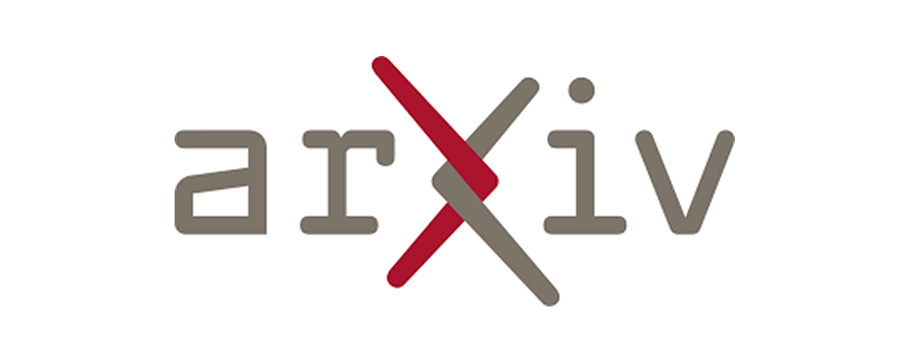

# 📰 AI & CG 每日资讯 - 2026-11-04

> 自动生成于 2026-11-04 11:29:06

## 🔥 GitHub Trending

["开源项目"]

GitHub

<a href="https://github.com/vercel-labs/agent-desktop" target="_blank" class="news-title-link">
<h3 class="news-title">agent-desktop</h3>
</a>

[EN] Computer use CLI for AI agents

        
开源项目

🔤 Rust
⭐ +3791

["开源项目"]

GitHub

<a href="https://github.com/D4Vinci/Scrapling" target="_blank" class="news-title-link">
<h3 class="news-title">Scrapling</h3>
</a>

[EN] 🕷️ The BEST Web Scraping framework that handles ever...

        
开源项目

🔤 Python
⭐ +1658

["游戏开发", "大语言模型", "开源项目"]

GitHub

<a href="https://github.com/Donchitos/Claude-Code-Game-Studios" target="_blank" class="news-title-link">
<h3 class="news-title">Claude-Code-Game-Studios</h3>
</a>

[EN] Turn Claude Code into a full game dev studio — 49 AI...

        
游戏开发 大语言模型 开源项目

🔤 Shell
⭐ +1182

["开源项目"]

GitHub

<a href="https://github.com/mattpocock/skills" target="_blank" class="news-title-link">
<h3 class="news-title">skills</h3>
</a>

[EN] Skills for Real Engineers. Straight from my .agents ...

        
开源项目

🔤 Shell
⭐ +1164

["大语言模型", "开源项目"]

GitHub

<a href="https://github.com/thedotmack/claude-mem" target="_blank" class="news-title-link">
<h3 class="news-title">claude-mem</h3>
</a>

[EN] Persistent Context Across Sessions for Every Agent –...

        
大语言模型 开源项目

🔤 TypeScript
⭐ +1139

["开源项目"]

GitHub

<a href="https://github.com/JustVugg/colibri" target="_blank" class="news-title-link">
<h3 class="news-title">colibri</h3>
</a>

[EN] A hierarchical inference engine for frontier MoE mod...

        
开源项目

🔤 C
⭐ +802

["大语言模型", "开源项目"]

GitHub

<a href="https://github.com/p-e-w/heretic" target="_blank" class="news-title-link">
<h3 class="news-title">heretic</h3>
</a>

[EN] Training-free language model modification: Remove ce...

        
大语言模型 开源项目

🔤 Python
⭐ +701

["开源项目"]

GitHub

<a href="https://github.com/shiyu-coder/Kronos" target="_blank" class="news-title-link">
<h3 class="news-title">Kronos</h3>
</a>

[EN] Kronos: A Foundation Model for the Language of Finan...

        
开源项目

🔤 Python
⭐ +503

["开源项目"]

GitHub

<a href="https://github.com/floci-io/floci" target="_blank" class="news-title-link">
<h3 class="news-title">floci</h3>
</a>

[EN] Light, fluffy, and always free - The AWS Local Emula...

        
开源项目

🔤 Java
⭐ +482

["开源项目"]

GitHub

<a href="https://github.com/max-sixty/worktrunk" target="_blank" class="news-title-link">
<h3 class="news-title">worktrunk</h3>
</a>

[EN] Worktrunk is a CLI for Git worktree management, desi...

        
开源项目

🔤 Rust
⭐ +438

## 🤗 Hugging Face Papers

> Daily Top Papers from hf.co/papers

["论文/研究", "机器学习"]

HuggingFace
2026-11-02T09:00:31.000Z

<a href="https://huggingface.co/papers/2611.02782" target="_blank" class="news-title-link">
<h3 class="news-title">History Forcing: Distilling History-Dependent Continuations for Long-Horizon Video World Models</h3>
</a>

[EN] History Forcing improves long-range consistency in few-step autoregressi...

        
论文/研究 机器学习

📄 Paper
👍 11

["论文/研究", "机器学习"]

HuggingFace
2026-11-02T00:00:00.000Z

<a href="https://huggingface.co/papers/2611.02497" target="_blank" class="news-title-link">
<h3 class="news-title">RoboColosseum: Evaluating Physical Intelligence at Scale In-The-Wild</h3>
</a>

[EN] RoboColosseum evaluates general robot policies across diverse embodiment...

        
论文/研究 机器学习

📄 Paper
👍 10

["论文/研究", "机器学习"]

HuggingFace
2026-11-02T00:00:00.000Z

<a href="https://huggingface.co/papers/2611.02737" target="_blank" class="news-title-link">
<h3 class="news-title">MoviEdit: Long-form Multi-Shot Video Editing Made Easy</h3>
</a>

[EN] MoviEdit is an end-to-end framework for long-form multi-shot video editi...

        
论文/研究 机器学习

📄 Paper
👍 7

["论文/研究", "机器学习"]

HuggingFace
2026-11-02T00:00:00.000Z

<a href="https://huggingface.co/papers/2611.02501" target="_blank" class="news-title-link">
<h3 class="news-title">SpecPilot: Autonomous Algorithm Discovery and Systems Optimization for Speculative Decoding</h3>
</a>

[EN] SpecPilot autonomously discovers deployment-specific algorithms and syst...

        
论文/研究 机器学习

📄 Paper
👍 6

["论文/研究", "机器学习"]

HuggingFace
2026-10-31T00:00:00.000Z

<a href="https://huggingface.co/papers/2611.01120" target="_blank" class="news-title-link">
<h3 class="news-title">StreamDuo: A Live Commentator and a Research Agent for Unseen Games</h3>
</a>

[EN] StreamDuo pairs a trainable commentator with a frozen research agent tha...

        
论文/研究 机器学习

📄 Paper
👍 4

["论文/研究", "图像生成", "机器学习"]

HuggingFace
2026-10-28T00:00:00.000Z

<a href="https://huggingface.co/papers/2610.38252" target="_blank" class="news-title-link">
<h3 class="news-title">A Tutorial on Generative Models for Music Audio</h3>
</a>

[EN] This monograph surveys neural methods for music audio generation, coveri...

        
论文/研究 图像生成 机器学习

📄 Paper
👍 3

["论文/研究", "机器学习"]

HuggingFace
2026-10-29T00:00:00.000Z

<a href="https://huggingface.co/papers/2610.40747" target="_blank" class="news-title-link">
<h3 class="news-title">Mage-VL-Cowork: A Full Training Recipe to Learn Hybrid Computer Use From Evolved Harnesses</h3>
</a>

[EN] Mage-VL-Cowork is a 4B hybrid computer-use agent trained via a progressi...

        
论文/研究 机器学习

📄 Paper
👍 2

["开源项目", "论文/研究", "机器学习"]

HuggingFace
2026-11-02T00:00:00.000Z

<a href="https://huggingface.co/papers/2611.04035" target="_blank" class="news-title-link">
<h3 class="news-title">Recursa: Toward Recursively Self-Improving Foundation Model Systems</h3>
</a>

[EN] Recursa is a self-improving foundation model system that adapts to new d...

        
开源项目 论文/研究 机器学习

📄 Paper
👍 2

["大语言模型", "论文/研究", "机器学习"]

HuggingFace
2026-11-01T00:00:00.000Z

<a href="https://huggingface.co/papers/2611.02079" target="_blank" class="news-title-link">
<h3 class="news-title">ParetoSaddler: Pareto-Guided Optimization of Agent Harnesses for Quality and Cost</h3>
</a>

[EN] ParetoSaddler improves LLM agent harnesses by separately promoting inter...

        
大语言模型 论文/研究 机器学习

📄 Paper
👍 2

["大语言模型", "图像生成", "论文/研究", "机器学习"]

HuggingFace
2026-11-02T00:00:00.000Z

<a href="https://huggingface.co/papers/2611.02568" target="_blank" class="news-title-link">
<h3 class="news-title">SeMo3D: Unifying 3D Generation, Editing, and Completion via Selective Modeling</h3>
</a>

[EN] SeMo3D unifies 3D generation, editing, and completion through selective ...

        
大语言模型 图像生成 论文/研究

📄 Paper
👍 1

## 🚀 Product Hunt 每日精选

["产品发布"]

ProductHunt

<a href="https://www.producthunt.com/products/scalekit" target="_blank" class="news-title-link">
<h3 class="news-title">AgentKit by Scalekit</h3>
</a>

[EN] MCP gateway for production agents that acts on your behalf

        
产品发布

🆕 Product
▲ 0

["产品发布"]

ProductHunt

<a href="https://www.producthunt.com/products/teamily-ai-human-ai-social-network" target="_blank" class="news-title-link">
<h3 class="news-title">Teamily AI</h3>
</a>

[EN] Your personal agent, agent teams & people in one messenger

        
产品发布

🆕 Product
▲ 0

["机器学习", "产品发布"]

ProductHunt

<a href="https://www.producthunt.com/products/magical-core-image-classifier" target="_blank" class="news-title-link">
<h3 class="news-title">MagicaLCore</h3>
</a>

[EN] Six kinds of machine learning models, trained on your iPad

        
机器学习 产品发布

🆕 Product
▲ 0

["产品发布"]

ProductHunt

<a href="https://www.producthunt.com/products/calendarly-calendar-on-lock-screen" target="_blank" class="news-title-link">
<h3 class="news-title">Calendarly</h3>
</a>

[EN] Your calendar and tasks, right on your iPhone Lock Screen

        
产品发布

🆕 Product
▲ 0

["产品发布"]

ProductHunt

<a href="https://www.producthunt.com/products/holdtalk" target="_blank" class="news-title-link">
<h3 class="news-title">HoldTalk</h3>
</a>

[EN] Hold fn, speak, and the text appears in any Mac app

        
产品发布

🆕 Product
▲ 0

["产品发布"]

ProductHunt

<a href="https://www.producthunt.com/products/corvo-3" target="_blank" class="news-title-link">
<h3 class="news-title">Corvo</h3>
</a>

[EN] A mailbox that tidies itself as mail arrives

        
产品发布

🆕 Product
▲ 0

["产品发布"]

ProductHunt

<a href="https://www.producthunt.com/products/openai" target="_blank" class="news-title-link">
<h3 class="news-title">LifeVal</h3>
</a>

[EN] OpenAI's benchmark for everyday life tasks with AI

        
产品发布

🆕 Product
▲ 0

["产品发布"]

ProductHunt

<a href="https://www.producthunt.com/products/hookdeck" target="_blank" class="news-title-link">
<h3 class="news-title">Hookdeck Inspect</h3>
</a>

[EN] Free webhook tester for you and your agent

        
产品发布

🆕 Product
▲ 0

["产品发布"]

ProductHunt

<a href="https://www.producthunt.com/products/vinsage" target="_blank" class="news-title-link">
<h3 class="news-title">VinSage</h3>
</a>

[EN] Free used-car check in Chrome's side panel, US & CA

        
产品发布

🆕 Product
▲ 0

["产品发布"]

ProductHunt

<a href="https://www.producthunt.com/products/lidcommit" target="_blank" class="news-title-link">
<h3 class="news-title">LidCommit</h3>
</a>

[EN] Auto-commit when you close your laptop lid

        
产品发布

🆕 Product
▲ 0

## 🎨 CG 图形学

> 覆盖: Unreal Engine | Three.js | Blender | Houdini | Unity | Godot | NVIDIA

["官方资讯", "Unreal Engine"]

Official
Tue, 03 Nov 2026 00:00:00 GMT

<a href="https://www.unrealengine.com/developer-interviews/no-law-crafting-a-living-breathing-cyber-noir-world-with-ue5" target="_blank" class="news-title-link">
<h3 class="news-title">NO LAW: Crafting a living, breathing cyber-noir world with UE5</h3>
</a>

[EN] NO LAW: Crafting a living, breathing cyber-noir world with UE5

        
官方资讯 Unreal Engine

🏛️ 官方 🤖 AI
🔥 100

["官方资讯", "开源项目", "Blender"]

Official
Wed, 23 Sep 2026 07:39:43 +0000

<a href="https://www.blender.org/news/blender-foundation-annual-report-2025/" target="_blank" class="news-title-link">
<h3 class="news-title">Blender Foundation Annual Report 2025</h3>
</a>

[EN] Blender Foundation Annual Report 2025

        
官方资讯 开源项目 Blender

🏛️ 官方 🤖 AI
🔥 100

["Unity", "官方资讯"]

Official
Fri, 30 Oct 2026 00:00:00 GMT

<a href="https://unity.com/blog/unity-industry-product-releases-2026" target="_blank" class="news-title-link">
<h3 class="news-title">2026 Industry releases and what’s coming in Q4</h3>
</a>

[EN] 2026 Industry releases and what’s coming in Q4

        
Unity 官方资讯

🏛️ 官方 🤖 AI
🔥 100

["官方资讯"]

Official
2026-11-02T23:39:34Z

<a href="https://developer.nvidia.com/blog/diagnose-distributed-ai-workload-failures-with-nvidia-attribution/" target="_blank" class="news-title-link">
<h3 class="news-title">Diagnose Distributed AI Workload Failures with NVIDIA Attribution</h3>
</a>

[EN] Diagnose Distributed AI Workload Failures with NVIDIA Attribution

        
官方资讯

🏛️ 官方 🤖 AI
🔥 100

["官方资讯", "Unreal Engine"]

Official
Thu, 29 Oct 2026 00:00:00 GMT

<a href="https://www.unrealengine.com/ue-devs-can-now-choose-to-train-ai-models-on-their-projects" target="_blank" class="news-title-link">
<h3 class="news-title">UE devs can now choose to train AI Models on their projects</h3>
</a>

[EN] UE devs can now choose to train AI Models on their projects

        
官方资讯 Unreal Engine

🏛️ 官方 🤖 AI
🔥 100

["Unity", "官方资讯"]

Official
Tue, 27 Oct 2026 00:00:00 GMT

<a href="https://unity.com/blog/video-game-terrain-guide" target="_blank" class="news-title-link">
<h3 class="news-title">How does terrain work in video games?</h3>
</a>

[EN] How does terrain work in video games?

        
Unity 官方资讯

🏛️ 官方 🤖 AI
🔥 100

["官方资讯"]

Official
2026-11-02T22:43:05Z

<a href="https://developer.nvidia.com/blog/keep-distributed-training-running-with-automated-workload-recovery/" target="_blank" class="news-title-link">
<h3 class="news-title">Keep Distributed Training Running with Automated Workload Recovery</h3>
</a>

[EN] Keep Distributed Training Running with Automated Workload Recovery

        
官方资讯

🏛️ 官方 🤖 AI
🔥 100

["官方资讯"]

Official
2026-11-02T18:00:00Z

<a href="https://developer.nvidia.com/blog/making-kubernetes-ai-ready-for-nvidia-vera-rubin-on-day-one/" target="_blank" class="news-title-link">
<h3 class="news-title">Making Kubernetes AI-Ready for NVIDIA Vera Rubin on Day One</h3>
</a>

[EN] Making Kubernetes AI-Ready for NVIDIA Vera Rubin on Day One

        
官方资讯

🏛️ 官方 🤖 AI
🔥 100

["官方资讯"]

Official
2026-11-02T17:00:00Z

<a href="https://developer.nvidia.com/blog/build-world-models-for-interactive-simulation-with-nvidia-cosmos/" target="_blank" class="news-title-link">
<h3 class="news-title">Build World Models for Interactive Simulation with NVIDIA Cosmos</h3>
</a>

[EN] Build World Models for Interactive Simulation with NVIDIA Cosmos

        
官方资讯

🏛️ 官方 🤖 AI
🔥 100

["官方资讯", "开源项目"]

Official
2026-11-02T16:00:00Z

<a href="https://developer.nvidia.com/blog/support-new-ai-frameworks-faster-using-nvidia-workload-map/" target="_blank" class="news-title-link">
<h3 class="news-title">Support New AI Frameworks Faster Using NVIDIA Workload Map</h3>
</a>

[EN] Support New AI Frameworks Faster Using NVIDIA Workload Map

        
官方资讯 开源项目

🏛️ 官方 🤖 AI
🔥 100

["官方资讯", "开源项目", "Three.js"]

Official
2026-10-30T08:03:18Z

<a href="https://github.com/mrdoob/three.js/releases/tag/r187" target="_blank" class="news-title-link">
<h3 class="news-title">r187</h3>
</a>

[EN] r187

        
官方资讯 开源项目 Three.js

🏛️ 官方
🔥 50

["官方资讯"]

Official
Thu, 29 Oct 2026 12:00:00 +0000

<a href="https://godotengine.org/article/dev-snapshot-godot-4-8-beta-2/" target="_blank" class="news-title-link">
<h3 class="news-title">Dev snapshot: Godot 4.8 beta 2</h3>
</a>

[EN] Dev snapshot: Godot 4.8 beta 2

        
官方资讯

🏛️ 官方
🔥 50

["官方资讯", "Unreal Engine", "实时渲染"]

Official
Mon, 02 Nov 2026 15:48:38 GMT

<a href="https://www.unrealengine.com/news/rivian-brings-ghostbusters-universe-to-halloween-mode-with-real-time-visuals-in-unreal-engine" target="_blank" class="news-title-link">
<h3 class="news-title">Rivian brings Ghostbusters universe to Halloween Mode, with real-time visuals in Unreal Engine</h3>
</a>

[EN] Rivian brings Ghostbusters universe to Halloween Mode, with real-time vi...

        
官方资讯 Unreal Engine 实时渲染

🏛️ 官方
🔥 50

["官方资讯", "Unreal Engine"]

Official
Wed, 28 Oct 2026 00:00:00 GMT

<a href="https://www.unrealengine.com/learning/octobers-epic-learning-content-mobile-development-in-unreal-engine" target="_blank" class="news-title-link">
<h3 class="news-title">October’s Epic learning content: Mobile development in Unreal Engine</h3>
</a>

[EN] October’s Epic learning content: Mobile development in Unreal Engine

        
官方资讯 Unreal Engine

🏛️ 官方
🔥 50

["官方资讯", "Unreal Engine"]

Official
Tue, 27 Oct 2026 00:00:00 GMT

<a href="https://www.unrealengine.com/news/mutable-sample-for-runtime-character-customization-now-updated-for-ue-5-8" target="_blank" class="news-title-link">
<h3 class="news-title">Mutable Sample for runtime character customization—now updated for UE 5.8!</h3>
</a>

[EN] Mutable Sample for runtime character customization—now updated for UE 5.8!

        
官方资讯 Unreal Engine

🏛️ 官方
🔥 50

## 💬 Hacker News 热议

["行业动态"]

HackerNews

<a href="https://blog.nns.ee/2026/11/02/renault-hack/" target="_blank" class="news-title-link">
<h3 class="news-title">Jailbreaking my car's navigation system just so I can change the time</h3>
</a>

[EN] Jailbreaking my car's navigation system just so I can change the time

        
行业动态

💬 271 评论
Points: 646

["行业动态"]

HackerNews

<a href="https://arstechnica.com/gadgets/2026/10/fujifilm-to-boost-tape-production-5x-as-ai-fuels-archiving-demand/" target="_blank" class="news-title-link">
<h3 class="news-title">Fujifilm to boost tape production 5x as AI fuels archiving demand</h3>
</a>

[EN] Fujifilm to boost tape production 5x as AI fuels archiving demand

        
行业动态

💬 174 评论
Points: 402

["行业动态"]

HackerNews

<a href="https://arxiv.org/abs/2605.29713" target="_blank" class="news-title-link">
<h3 class="news-title">The Little Book of Generative AI Foundations: An Intuitive Mathematical Primer</h3>
</a>

[EN] The Little Book of Generative AI Foundations: An Intuitive Mathematical ...

        
行业动态

💬 45 评论
Points: 260

["行业动态"]

HackerNews

<a href="https://github.com/postmanlabs/postman-app-support/issues/14370" target="_blank" class="news-title-link">
<h3 class="news-title">Postman silently auto-installs AI plugins and attempts to share all API data</h3>
</a>

[EN] Postman silently auto-installs AI plugins and attempts to share all API ...

        
行业动态

💬 358 评论
Points: 1084

["行业动态"]

HackerNews

<a href="https://www.figma.com/blog/training-a-figma-fluent-editing-model/" target="_blank" class="news-title-link">
<h3 class="news-title">We're training a Figma-fluent editing model</h3>
</a>

[EN] We're training a Figma-fluent editing model

        
行业动态

💬 40 评论
Points: 83

["行业动态"]

HackerNews

<a href="https://github.com/finic-ai/kairos" target="_blank" class="news-title-link">
<h3 class="news-title">Show HN: Kairos – Open-source risk and fraud decisioning platform</h3>
</a>

[EN] Show HN: Kairos – Open-source risk and fraud decisioning platform

        
行业动态

💬 8 评论
Points: 70

["行业动态"]

HackerNews

<a href="https://ben.stolovitz.com/posts/how-use-ai-oct-2026/" target="_blank" class="news-title-link">
<h3 class="news-title">How I use AI (Oct 2026)</h3>
</a>

[EN] How I use AI (Oct 2026)

        
行业动态

💬 88 评论
Points: 101

["行业动态"]

HackerNews

<a href="https://news.ycombinator.com/item?id=50352757" target="_blank" class="news-title-link">
<h3 class="news-title">OpenAI seems to be silently re-enabling model training on Codex chats</h3>
</a>

[EN] OpenAI seems to be silently re-enabling model training on Codex chats

        
行业动态

💬 139 评论
Points: 443

["行业动态"]

HackerNews

<a href="https://asia.nikkei.com/business/technology/artificial-intelligence/us-tech-giants-hidden-ai-debt-swells-90-to-3.2tn-in-6-months" target="_blank" class="news-title-link">
<h3 class="news-title">US tech giants' hidden AI debt swells 90% to $3.2T in 6 months</h3>
</a>

[EN] US tech giants' hidden AI debt swells 90% to $3.2T in 6 months

        
行业动态

💬 129 评论
Points: 295

["行业动态"]

HackerNews

<a href="https://www.nytimes.com/2026/11/03/us/google-search-schools-restrict-ai.html" target="_blank" class="news-title-link">
<h3 class="news-title">Google will turn off search for schools that reject AI</h3>
</a>

[EN] Google will turn off search for schools that reject AI

        
行业动态

💬 417 评论
Points: 569

## 🎓 学术前沿 (arXiv)

["实时渲染", "论文/研究"]

arXiv
2026-11-02T12:30:21Z

<a href="https://arxiv.org/pdf/2611.03033v1" target="_blank" class="news-title-link">
<h3 class="news-title">GPU-Native Real-Time Textured Mesh Reconstruction with Seam-Aware Multi-View Radiometric Correction</h3>
</a>

[EN] GPU-Native Real-Time Textured Mesh Reconstruction with Seam-Aware Multi-View Radiometric Cor...

        
实时渲染 论文/研究

✍️ Hiroyuki Sato
📄 PDF

["图像生成", "论文/研究"]

arXiv
2026-11-02T11:34:22Z

<a href="https://arxiv.org/pdf/2611.02964v1" target="_blank" class="news-title-link">
<h3 class="news-title">One Image Is Enough: Self-Generated Supervision for Personalizing Human Video Diffusion at Test Time</h3>
</a>

[EN] One Image Is Enough: Self-Generated Supervision for Personalizing Human Video Diffusion at T...

        
图像生成 论文/研究

✍️ Xinxin Zuo
📄 PDF

["图像生成", "论文/研究"]

arXiv
2026-11-02T06:57:14Z

<a href="https://arxiv.org/pdf/2611.02631v1" target="_blank" class="news-title-link">
<h3 class="news-title">UniCross3D: Unified Cross-View and Cross-Domain Diffusion for Consistent Single-Image 3D Generation</h3>
</a>

[EN] UniCross3D: Unified Cross-View and Cross-Domain Diffusion for Consistent Single-Image 3D Gen...

        
图像生成 论文/研究

✍️ Jiwoo Kang
📄 PDF

["NeRF/3DGS", "论文/研究"]

arXiv
2026-11-01T04:05:12Z

<a href="https://arxiv.org/pdf/2611.01534v1" target="_blank" class="news-title-link">
<h3 class="news-title">AbacusGS: Gaussian Splatting without Per-Splat Sorting</h3>
</a>

[EN] AbacusGS: Gaussian Splatting without Per-Splat Sorting

        
NeRF/3DGS 论文/研究

✍️ Peihua Mai
📄 PDF

["计算机视觉", "图像生成", "论文/研究"]

arXiv
2026-11-03T12:11:03Z

<a href="https://arxiv.org/pdf/2611.04764v1" target="_blank" class="news-title-link">
<h3 class="news-title">Pixel-space video generation with U-JiT</h3>
</a>

[EN] Pixel-space video generation with U-JiT

        
计算机视觉 图像生成 论文/研究

✍️ Matthieu Cord
📄 PDF

["计算机视觉", "论文/研究"]

arXiv
2026-11-03T12:06:58Z

<a href="https://arxiv.org/pdf/2611.04755v1" target="_blank" class="news-title-link">
<h3 class="news-title">iMED: A Multi-Endoscope Dataset for Surgical 3D Perception</h3>
</a>

[EN] iMED: A Multi-Endoscope Dataset for Surgical 3D Perception

        
计算机视觉 论文/研究

✍️ Omid Mohareri
📄 PDF

["计算机视觉", "图像生成", "论文/研究"]

arXiv
2026-11-03T11:35:05Z

<a href="https://arxiv.org/pdf/2611.04712v1" target="_blank" class="news-title-link">
<h3 class="news-title">VISAGE: Vertex-based Intrinsic Surface Appearance GEneration via Dual-Stream Diffusion for Arbitrary 3D Heads</h3>
</a>

[EN] VISAGE: Vertex-based Intrinsic Surface Appearance GEneration via Dual-Stream Diffusion for A...

        
计算机视觉 图像生成 论文/研究

✍️ Didier Stricker
📄 PDF

["计算机视觉", "论文/研究"]

arXiv
2026-11-03T11:31:33Z

<a href="https://arxiv.org/pdf/2611.04710v1" target="_blank" class="news-title-link">
<h3 class="news-title">DenseTwins: Dense Modality Decoupling for Multimodal Self-Supervision</h3>
</a>

[EN] DenseTwins: Dense Modality Decoupling for Multimodal Self-Supervision

        
计算机视觉 论文/研究

✍️ Giacomo Boracchi
📄 PDF

["NeRF/3DGS", "论文/研究"]

arXiv
2026-11-03T10:51:33Z

<a href="https://arxiv.org/pdf/2611.04666v1" target="_blank" class="news-title-link">
<h3 class="news-title">Phase-DGS: Phase-guided Dynamic Gaussian Splatting from Unsynchronized Multi-view Video</h3>
</a>

[EN] Phase-DGS: Phase-guided Dynamic Gaussian Splatting from Unsynchronized Multi-view Video

        
NeRF/3DGS 论文/研究

✍️ Hyon-Gon Choo
📄 PDF

["论文/研究"]

arXiv
2026-11-02T18:39:17Z

<a href="https://arxiv.org/pdf/2611.03775v1" target="_blank" class="news-title-link">
<h3 class="news-title">FlowRig: Unified Skeleton Generation for 3D and 4D Meshes via Flow Matching</h3>
</a>

[EN] FlowRig: Unified Skeleton Generation for 3D and 4D Meshes via Flow Matching

        
论文/研究

✍️ Cheng Zhang
📄 PDF

---