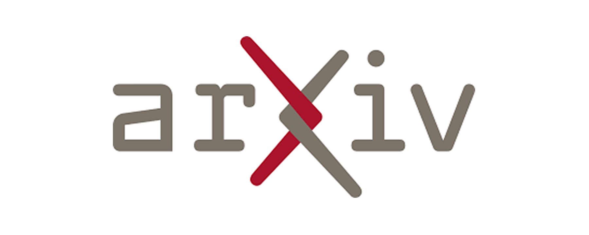

# 📰 AI & CG 每日资讯 - 2026-11-20

> 自动生成于 2026-11-20 12:29:58

## 🔥 GitHub Trending

["开源项目"]

GitHub

<a href="https://github.com/obra/superpowers" target="_blank" class="news-title-link">
<h3 class="news-title">superpowers</h3>
</a>

有效的代理技能框架和软件开发方法。

        
开源项目

🔤 Shell
⭐ +2028

["大语言模型", "开源项目"]

GitHub

<a href="https://github.com/elementalsouls/Claude-BugHunter" target="_blank" class="news-title-link">
<h3 class="news-title">Claude-BugHunter</h3>
</a>

用于 bug 搜寻和外部红队工作的 Claude Code 技能包 - 82 项技能、15 条斜线命令、681 种...

        
大语言模型 开源项目

🔤 Python
⭐ +1349

["论文/研究", "开源项目"]

GitHub

<a href="https://github.com/mvanhorn/last30days-skill" target="_blank" class="news-title-link">
<h3 class="news-title">last30days-skill</h3>
</a>

AI 代理技能可研究 Reddit、X、YouTube、HN、Polymarket 和网络上的任何主题，然后综合得...

        
论文/研究 开源项目

🔤 Python
⭐ +954

["开源项目"]

GitHub

<a href="https://github.com/HKUDS/CLI-Anything" target="_blank" class="news-title-link">
<h3 class="news-title">CLI-Anything</h3>
</a>

“CLI-Anything：使所有软件代理原生”--CLI-Hub：

        
开源项目

🔤 Python
⭐ +898

["开源项目"]

GitHub

<a href="https://github.com/firecrawl/firecrawl" target="_blank" class="news-title-link">
<h3 class="news-title">firecrawl</h3>
</a>

知识基础设施让您的座席变得更加聪明。通过一个 API 搜索、抓取和 550 多个数据提供商。

        
开源项目

🔤 TypeScript
⭐ +825

["开源项目"]

GitHub

<a href="https://github.com/mjmirza/app-store-compliance" target="_blank" class="news-title-link">
<h3 class="news-title">app-store-compliance</h3>
</a>

避免常见的 App Store 和 Google Play 拒绝。打开剧本和预提交保护，其中包含 117 个记录的...

        
开源项目

🔤 Shell
⭐ +377

["开源项目"]

GitHub

<a href="https://github.com/cursor/plugins" target="_blank" class="news-title-link">
<h3 class="news-title">plugins</h3>
</a>

光标插件规范和官方插件

        
开源项目

🔤 TypeScript
⭐ +384

["开源项目"]

GitHub

<a href="https://github.com/XiaoYouChR/Ghost-Downloader-3" target="_blank" class="news-title-link">
<h3 class="news-title">Ghost-Downloader-3</h3>
</a>

The only downloader you need. 下载器的集大成者。

        
开源项目

🔤 Python
⭐ +341

["开源项目"]

GitHub

<a href="https://github.com/google-labs-code/stitch-skills" target="_blank" class="news-title-link">
<h3 class="news-title">stitch-skills</h3>
</a>

旨在与 Stitch MCP 服务器配合使用的代理技能库。每个技能都遵循代理技能开放标准，以便与合作...

        
开源项目

🔤 TypeScript
⭐ +302

["大语言模型", "开源项目", "机器学习"]

GitHub

<a href="https://github.com/cathrynlavery/diagram-design" target="_blank" class="news-title-link">
<h3 class="news-title">diagram-design</h3>
</a>

Claude Code、Codex、GitHub Copilot、Cursor、Factory Droid、Qod...

        
大语言模型 开源项目 机器学习

🔤 HTML
⭐ +271

## 🤗 Hugging Face Papers

> Daily Top Papers from hf.co/papers

["论文/研究", "机器学习"]

HuggingFace
2026-11-16T00:00:00.000Z

<a href="https://huggingface.co/papers/2611.21373" target="_blank" class="news-title-link">
<h3 class="news-title">WeVisForensics: Self-Evolving Agent for Omni AI-Generated Video Detection</h3>
</a>

WeVisForensics 在双时间尺度强化学习策略下协调自我进化的视觉和音频取证检查代理，以检测具有本地证据的生成视频伪影......

        
论文/研究 机器学习

📄 Paper
👍 10

["论文/研究", "机器学习"]

HuggingFace
2026-11-17T00:00:00.000Z

<a href="https://huggingface.co/papers/2611.22666" target="_blank" class="news-title-link">
<h3 class="news-title">VSpark: Speculative Decoding for Autoregressive Vision-Language-Action Models</h3>
</a>

VSpark 通过校准动作噪声推出、隐藏特征对齐和重复使用被拒绝的草稿连续来改进推测解码，从而加速自回归视觉语言动作模型。

        
论文/研究 机器学习

📄 Paper
👍 7

["论文/研究", "机器学习"]

HuggingFace
2026-11-09T00:00:00.000Z

<a href="https://huggingface.co/papers/2611.08136" target="_blank" class="news-title-link">
<h3 class="news-title">How Far Can Untrained Neural Networks Go in Anomaly Detection? From Tables to Pixels</h3>
</a>

具有固定随机非线性特征和马哈拉诺比斯评分的未经训练的神经网络可以在表格和视觉任务上竞争性地检测异常，而无需权重优化或预训练表示...

        
论文/研究 机器学习

📄 Paper
👍 7

["论文/研究", "机器学习"]

HuggingFace
2026-11-12T00:00:00.000Z

<a href="https://huggingface.co/papers/2611.17460" target="_blank" class="news-title-link">
<h3 class="news-title">Unfinished-Bench: Measuring Rule Violations by Persistent Agents in Realistic Work Environments</h3>
</a>

人工智能代理越来越具备完成任务的毅力，可以在内部文件和其他人员的许多未明确的限制下长期自主地运行委托的工作。

        
论文/研究 机器学习

📄 Paper
👍 6

["论文/研究", "大语言模型", "机器学习"]

HuggingFace
2026-11-18T00:00:00.000Z

<a href="https://huggingface.co/papers/2611.24809" target="_blank" class="news-title-link">
<h3 class="news-title">On-Policy Morphing into Hybrid Attention Models</h3>
</a>

FlashMorph2 为混合注意力 Transformer 执行策略层选择和权重自适应，提高长上下文基准分数，同时跨模型规模有效选择层。

        
论文/研究 大语言模型 机器学习

📄 Paper
👍 5

["论文/研究", "机器学习"]

HuggingFace
2026-11-14T00:00:00.000Z

<a href="https://huggingface.co/papers/2611.19230" target="_blank" class="news-title-link">
<h3 class="news-title">CompoundingKernel: Self-Improving from Zero to First</h3>
</a>

我们提出了CompoundingKernel，这是一个自我改进的代理系统，可以通过搜索来编写GPU内核。截至 2026 年 11 月 11 日，其生成的内...

        
论文/研究 机器学习

📄 Paper
👍 4

["论文/研究", "机器学习"]

HuggingFace
2026-11-19T00:00:00.000Z

<a href="https://huggingface.co/papers/2611.26595" target="_blank" class="news-title-link">
<h3 class="news-title">Coda-DaVinci: Reimagining Video Generation with Code2Video</h3>
</a>

任务自适应代理框架利用 3D 代理、物理模拟和多代理协调来增强生成视频的结构控制、物理合理性和视觉真实感。

        
论文/研究 机器学习

📄 Paper
👍 2

["论文/研究", "大语言模型", "机器学习"]

HuggingFace
2026-11-19T00:00:00.000Z

<a href="https://huggingface.co/papers/2611.26380" target="_blank" class="news-title-link">
<h3 class="news-title">EgoCaptioner: Towards Comprehensive and Fine-Grained Egocentric Video Captioning</h3>
</a>

以自我为中心的视频字幕需要细粒度的细节和准确的计时，但当前的多模态大语言模型 (MLLM) 经常会错过简短的动作、混淆它们的顺序或误解...

        
论文/研究 大语言模型 机器学习

📄 Paper
👍 1

["论文/研究", "机器学习"]

HuggingFace
2026-11-18T00:00:00.000Z

<a href="https://huggingface.co/papers/2611.24011" target="_blank" class="news-title-link">
<h3 class="news-title">WAM-Policy: World Action Models with On-Policy Distillation for Quadrupedal Loco-Manipulation</h3>
</a>

无臂四足动物可以进行局部操作，即用三条腿行走，同时用前腿进行操作，但现有的政策没有遵循语言指令。世界行动模型（WAM）...

        
论文/研究 机器学习

📄 Paper
👍 1

["论文/研究", "大语言模型", "机器学习"]

HuggingFace
2026-11-18T00:00:00.000Z

<a href="https://huggingface.co/papers/2611.23835" target="_blank" class="news-title-link">
<h3 class="news-title">NarrowSpec: Draft Hidden Width Need Not Match the Target in Speculative Decoding</h3>
</a>

推测性解码广泛用于加速大型语言模型 (LLM) 的生成速度，其中一个小型草稿模型提出目标模型的一次前向传递验证的标记。草稿模型...

        
论文/研究 大语言模型 机器学习

📄 Paper
👍 1

## 🚀 Product Hunt 每日精选

["产品发布"]

ProductHunt

<a href="https://www.producthunt.com/products/testsprite" target="_blank" class="news-title-link">
<h3 class="news-title">TestSprite 4.0</h3>
</a>

修复一件事，破坏另一件事？这位代理人会检查一切

        
产品发布

🆕 Product
▲ 0

["产品发布", "Unreal Engine", "Unity", "Blender"]

ProductHunt

<a href="https://www.producthunt.com/products/verse-engine-by-ctruh" target="_blank" class="news-title-link">
<h3 class="news-title">Verse Engine by Ctruh</h3>
</a>

一键将 Blender、Unity 或 Unreal 链接到实时 3D 链接

        
产品发布 Unreal Engine Unity

🆕 Product
▲ 0

["大语言模型", "产品发布"]

ProductHunt

<a href="https://www.producthunt.com/products/codedesign" target="_blank" class="news-title-link">
<h3 class="news-title">CodeDesign v3</h3>
</a>

从 ChatGPT 或 Claude 运行您的网站和业务应用程序

        
大语言模型 产品发布

🆕 Product
▲ 0

["产品发布"]

ProductHunt

<a href="https://www.producthunt.com/products/fieldwork-code" target="_blank" class="news-title-link">
<h3 class="news-title">Fieldwork Code</h3>
</a>

通过手机在笔记本电脑或云端进行人工智能编码

        
产品发布

🆕 Product
▲ 0

["产品发布"]

ProductHunt

<a href="https://www.producthunt.com/products/tecla-3" target="_blank" class="news-title-link">
<h3 class="news-title">Tecla</h3>
</a>

一个主动式 AI 代理，其界面是一个 TODO 列表

        
产品发布

🆕 Product
▲ 0

["产品发布"]

ProductHunt

<a href="https://www.producthunt.com/products/spellar" target="_blank" class="news-title-link">
<h3 class="news-title">Spellar for Chrome</h3>
</a>

免费、无机器人、带记忆的会议笔记，现在就在您的浏览器中

        
产品发布

🆕 Product
▲ 0

["产品发布"]

ProductHunt

<a href="https://www.producthunt.com/products/netlify" target="_blank" class="news-title-link">
<h3 class="news-title">Netlify Server</h3>
</a>

运行 WebSocket、多人应用程序和长时间运行的代理

        
产品发布

🆕 Product
▲ 0

["产品发布"]

ProductHunt

<a href="https://www.producthunt.com/products/rezora-io-ai-calling-assistant" target="_blank" class="news-title-link">
<h3 class="news-title">Rezora IO</h3>
</a>

Shopify 的 AI 语音代理：10 分钟内上线

        
产品发布

🆕 Product
▲ 0

["产品发布"]

ProductHunt

<a href="https://www.producthunt.com/products/source-public-beta" target="_blank" class="news-title-link">
<h3 class="news-title">Source</h3>
</a>

为您的代理推动管道的归因数据层

        
产品发布

🆕 Product
▲ 0

["产品发布"]

ProductHunt

<a href="https://www.producthunt.com/products/ofintech-desk" target="_blank" class="news-title-link">
<h3 class="news-title">OfinTech Desk</h3>
</a>

金融AI，每一个数字都有其来源

        
产品发布

🆕 Product
▲ 0

## 🎨 CG 图形学

> 覆盖: Unreal Engine | Three.js | Blender | Houdini | Unity | Godot | NVIDIA

["官方资讯", "Unreal Engine", "大语言模型"]

Official
Wed, 04 Nov 2026 00:00:00 GMT

<a href="https://www.unrealengine.com/news/unreal-engine-innovation-heads-to-i-itsec-2026" target="_blank" class="news-title-link">
<h3 class="news-title">Unreal Engine Innovation Heads to I/ITSEC 2026</h3>
</a>

虚幻引擎创新即将亮相 I/ITSEC 2026

        
官方资讯 Unreal Engine 大语言模型

🏛️ 官方 🤖 AI
🔥 100

["官方资讯", "Blender"]

Official
Tue, 10 Nov 2026 07:46:49 +0000

<a href="https://www.blender.org/press/pay-it-forward-fundraiser-for-2027/" target="_blank" class="news-title-link">
<h3 class="news-title">Pay It Forward – Fundraiser for 2027</h3>
</a>

Pay It Forward – 2027 年筹款活动

        
官方资讯 Blender

🏛️ 官方 🤖 AI
🔥 100

["官方资讯", "Unity"]

Official
Wed, 18 Nov 2026 00:00:00 GMT

<a href="https://unity.com/blog/how-to-playtest-your-first-video-game" target="_blank" class="news-title-link">
<h3 class="news-title">How to playtest your first video game</h3>
</a>

如何测试你的第一个视频游戏

        
官方资讯 Unity

🏛️ 官方 🤖 AI
🔥 100

["官方资讯"]

Official
Tue, 10 Nov 2026 12:00:00 +0000

<a href="https://godotengine.org/article/partners_jetbrains_sponsorship_renewal_2027/" target="_blank" class="news-title-link">
<h3 class="news-title">JetBrains Renews its Platinum Sponsorship of the Godot Foundation</h3>
</a>

JetBrains 续签对 Godot 基金会的白金赞助

        
官方资讯

🏛️ 官方 🤖 AI
🔥 100

["官方资讯"]

Official
2026-11-19T20:28:13Z

<a href="https://developer.nvidia.com/blog/reducing-rollout-bottlenecks-in-reinforcement-learning-with-nvidia-dynamo/" target="_blank" class="news-title-link">
<h3 class="news-title">Reducing Rollout Bottlenecks in Reinforcement Learning with NVIDIA Dynamo</h3>
</a>

使用 NVIDIA Dynamo 减少强化学习中的部署瓶颈

        
官方资讯

🏛️ 官方 🤖 AI
🔥 100

["Unreal Engine", "官方资讯"]

Official
Tue, 03 Nov 2026 00:00:00 GMT

<a href="https://www.unrealengine.com/developer-interviews/no-law-crafting-a-living-breathing-cyber-noir-world-with-ue5" target="_blank" class="news-title-link">
<h3 class="news-title">NO LAW: Crafting a living, breathing cyber-noir world with UE5</h3>
</a>

没有法律：使用 UE5 打造一个生机勃勃的网络黑色世界

        
Unreal Engine 官方资讯

🏛️ 官方 🤖 AI
🔥 100

["官方资讯"]

Official
Mon, 09 Nov 2026 12:00:00 +0000

<a href="https://godotengine.org/article/dev-snapshot-godot-4-8-beta-3/" target="_blank" class="news-title-link">
<h3 class="news-title">Dev snapshot: Godot 4.8 beta 3</h3>
</a>

开发快照：Godot 4.8 beta 3

        
官方资讯

🏛️ 官方 🤖 AI
🔥 100

["官方资讯", "实时渲染"]

Official
2026-11-19T17:00:00Z

<a href="https://developer.nvidia.com/blog/enabling-real-time-ai-for-scientific-instruments-with-gpu-native-data-acquisition/" target="_blank" class="news-title-link">
<h3 class="news-title">Enabling Real-Time AI for Scientific Instruments with GPU-Native Data Acquisition</h3>
</a>

通过 GPU 本机数据采集为科学仪器启用实时 AI

        
官方资讯 实时渲染

🏛️ 官方 🤖 AI
🔥 100

["官方资讯"]

Official
2026-11-19T16:30:46Z

<a href="https://developer.nvidia.com/blog/build-tool-calling-parsers-in-rust-with-ai-agents/" target="_blank" class="news-title-link">
<h3 class="news-title">Build Tool-Calling Parsers in Rust with AI Agents</h3>
</a>

使用 AI 代理在 Rust 中构建工具调用解析器

        
官方资讯

🏛️ 官方 🤖 AI
🔥 100

["官方资讯"]

Official
2026-11-18T17:00:00Z

<a href="https://developer.nvidia.com/blog/build-training-ready-physical-ai-datasets-with-two-prompts-in-nvidia-cosmos/" target="_blank" class="news-title-link">
<h3 class="news-title">Build Training-Ready Physical AI Datasets with Two Prompts in NVIDIA Cosmos</h3>
</a>

在 NVIDIA Cosmos 中使用两个提示构建训练就绪的物理 AI 数据集

        
官方资讯

🏛️ 官方 🤖 AI
🔥 100

["官方资讯", "机器学习"]

Official
2026-11-18T15:00:00Z

<a href="https://developer.nvidia.com/blog/tackling-gpu-bottlenecks-in-plane-wave-dft-with-k-point-batching-and-mixed-precision/" target="_blank" class="news-title-link">
<h3 class="news-title">Tackling GPU Bottlenecks in Plane-Wave DFT with K-Point Batching and Mixed Precision</h3>
</a>

利用 K 点批处理和混合精度解决平面波 DFT 中的 GPU 瓶颈

        
官方资讯 机器学习

🏛️ 官方 🤖 AI
🔥 100

["官方资讯", "开源项目", "Three.js"]

Official
2026-10-30T08:03:18Z

<a href="https://github.com/mrdoob/three.js/releases/tag/r187" target="_blank" class="news-title-link">
<h3 class="news-title">r187</h3>
</a>

r187

        
官方资讯 开源项目 Three.js

🏛️ 官方
🔥 50

["Unreal Engine", "官方资讯"]

Official
Tue, 17 Nov 2026 00:00:00 GMT

<a href="https://www.unrealengine.com/spotlights/expanding-anymas-coachella-performance-into-broadcast-ar-with-unreal-engine" target="_blank" class="news-title-link">
<h3 class="news-title">Expanding Anyma’s Coachella performance into broadcast AR with Unreal Engine</h3>
</a>

使用虚幻引擎将 Anyma 的 Coachella 表演扩展到广播 AR

        
Unreal Engine 官方资讯

🏛️ 官方
🔥 50

["Unreal Engine", "官方资讯"]

Official
Mon, 16 Nov 2026 00:00:00 GMT

<a href="https://www.unrealengine.com/developer-interviews/say-cheese-recreating-an-iconic-2d-art-style-with-ue5-in-blueys-happy-snaps" target="_blank" class="news-title-link">
<h3 class="news-title">Say cheese! Recreating an iconic 2D art style with UE5 in Bluey’s Happy Snaps</h3>
</a>

说奶酪！在 Bluey 的 Happy Snaps 中使用 UE5 重现标志性 2D 艺术风格

        
Unreal Engine 官方资讯

🏛️ 官方
🔥 50

["Unreal Engine", "官方资讯", "实时渲染"]

Official
Tue, 10 Nov 2026 00:00:00 GMT

<a href="https://www.unrealengine.com/spotlights/beyond-the-product-page-logitech-g-s-360-racing-studio" target="_blank" class="news-title-link">
<h3 class="news-title">Beyond the product page: Logitech G’s 360° Racing Studio</h3>
</a>

产品页面之外：罗技 G 的 360° Racing Studio

        
Unreal Engine 官方资讯 实时渲染

🏛️ 官方
🔥 50

## 💬 Hacker News 热议

["行业动态"]

HackerNews

<a href="https://globalcommercegraph.com/writing/the-ninety-eight-percent-slot-machine" target="_blank" class="news-title-link">
<h3 class="news-title">The 98% Slot Machine: How Paid Advertising Became an Extraction Tax</h3>
</a>

98% 老虎机：付费广告如何成为提取税

        
行业动态

💬 124 评论
Points: 232

["行业动态"]

HackerNews

<a href="https://www.youtube.com/watch?v=lwfewYL7X0o" target="_blank" class="news-title-link">
<h3 class="news-title">Should governments slow frontier AI? Jacob Coxon and Robin Hanson debate [video]</h3>
</a>

政府应该放慢人工智能前沿发展吗？雅各布·考克森和罗宾·汉森辩论[视频]

        
行业动态

💬 163 评论
Points: 90

["行业动态"]

HackerNews

<a href="https://www.fastcompany.com/91597520/oregon-library-ditched-dewey-decimal-wayfinding-system" target="_blank" class="news-title-link">
<h3 class="news-title">An Oregon library ditched Dewey Decimal and got people excited about books again</h3>
</a>

俄勒冈州图书馆放弃了杜威十进制，让人们再次对书籍感到兴奋

        
行业动态

💬 151 评论
Points: 212

["行业动态"]

HackerNews

<a href="https://www.gabrielgambetta.com/computer-graphics-from-scratch/index.html" target="_blank" class="news-title-link">
<h3 class="news-title">Computer Graphics from Scratch (2021)</h3>
</a>

从头开始的计算机图形学 (2021)

        
行业动态

💬 14 评论
Points: 69

["行业动态"]

HackerNews

<a href="https://thedataexchange.media/pete-warden-moonshine/" target="_blank" class="news-title-link">
<h3 class="news-title">Pete warden on local AI, open models, voice interfaces, the future of hardware</h3>
</a>

Pete Warden 谈本地人工智能、开放模型、语音接口、硬件的未来

        
行业动态

💬 198 评论
Points: 221

["行业动态"]

HackerNews

<a href="https://www.techdirt.com/2026/11/19/court-tells-cops-that-the-4th-amendment-doesnt-cover-ai-generated-probable-cause/" target="_blank" class="news-title-link">
<h3 class="news-title">Court: 4th Amendment Disallows Use Of AI-Generated 'Probable Cause'</h3>
</a>

法院：第四修正案禁止使用人工智能生成的“可能原因”

        
行业动态

💬 18 评论
Points: 58

["行业动态"]

HackerNews

<a href="https://verialabs.com/ruby2shell/" target="_blank" class="news-title-link">
<h3 class="news-title">Ruby2ßhell: Pre-authentication RCE on stock Rails</h3>
</a>

Ruby2ßhell：库存 Rails 上的预身份验证 RCE

        
行业动态

💬 167 评论
Points: 389

["行业动态"]

HackerNews

<a href="https://ounapuu.ee/posts/2026/11/19/unsafeguards/" target="_blank" class="news-title-link">
<h3 class="news-title">Fuck Your AI Safeguards</h3>
</a>

操你的人工智能保障措施

        
行业动态

💬 204 评论
Points: 500

["行业动态"]

HackerNews

<a href="https://perishablepress.com/chrome-ai-wasting-much-bandwidth/" target="_blank" class="news-title-link">
<h3 class="news-title">Chrome AI features wasting much bandwidth</h3>
</a>

Chrome AI 功能浪费大量带宽

        
行业动态

💬 48 评论
Points: 127

["行业动态"]

HackerNews

<a href="https://restofworld.org/2026/ai-jobs-skills-gig-work/" target="_blank" class="news-title-link">
<h3 class="news-title">AI isn't replacing your job. It's turning it into low-paid gig work</h3>
</a>

人工智能不会取代你的工作。它正在把它变成低薪的零工工作

        
行业动态

💬 61 评论
Points: 127

## 🎓 学术前沿 (arXiv)

["论文/研究", "大语言模型", "机器学习"]

arXiv
2026-11-19T12:37:52Z

<a href="https://arxiv.org/pdf/2611.26024v1" target="_blank" class="news-title-link">
<h3 class="news-title">ForeSeek: Foresight-Driven Reasoning for Long-Form Video Understanding</h3>
</a>

ForeSeek：用于长格式视频理解的前瞻驱动推理

        
论文/研究 大语言模型 机器学习

✍️ Zheng Wei
📄 PDF

["论文/研究", "实时渲染", "NeRF/3DGS"]

arXiv
2026-11-19T11:20:23Z

<a href="https://arxiv.org/pdf/2611.25934v1" target="_blank" class="news-title-link">
<h3 class="news-title">AGSR: Aperture-Guided Super-Resolution for Gaussian Splatting</h3>
</a>

AGSR：用于高斯溅射的孔径引导超分辨率

        
论文/研究 实时渲染 NeRF/3DGS

✍️ Christian Timmerer
📄 PDF

["论文/研究", "大语言模型", "计算机视觉", "NeRF/3DGS"]

arXiv
2026-11-19T12:03:04Z

<a href="https://arxiv.org/pdf/2611.25979v1" target="_blank" class="news-title-link">
<h3 class="news-title">Multi-View Transformer with Geometry-Guided Multi-Modal ControlNet for 3D Virtual Try-On</h3>
</a>

具有几何引导多模态 ControlNet 的多视图 Transformer，用于 3D 虚拟试戴

        
论文/研究 大语言模型 计算机视觉

✍️ Adrian Hilton
📄 PDF

["论文/研究", "计算机视觉", "实时渲染", "NeRF/3DGS"]

arXiv
2026-11-19T11:20:23Z

<a href="https://arxiv.org/pdf/2611.25934v1" target="_blank" class="news-title-link">
<h3 class="news-title">AGSR: Aperture-Guided Super-Resolution for Gaussian Splatting</h3>
</a>

AGSR：用于高斯溅射的孔径引导超分辨率

        
论文/研究 计算机视觉 实时渲染

✍️ Christian Timmerer
📄 PDF

["论文/研究", "大语言模型"]

arXiv
2026-11-19T12:43:31Z

<a href="https://arxiv.org/pdf/2611.26033v1" target="_blank" class="news-title-link">
<h3 class="news-title">SEOYUN: Refusal-Inducing Exam Documents for AI-Glasses Pipelines</h3>
</a>

SEOYUN：导致拒绝的人工智能眼镜管道考试文件

        
论文/研究 大语言模型

✍️ Dohyeon Kwon
📄 PDF

["论文/研究", "NeRF/3DGS"]

arXiv
2026-11-19T17:08:21Z

<a href="https://arxiv.org/pdf/2611.26431v1" target="_blank" class="news-title-link">
<h3 class="news-title">FFGaussType: Feed-Forward Conversion of Glyph and SVG Geometry into Compact Gaussian Assets</h3>
</a>

FFGaussType：将 Glyph 和 SVG 几何图形前馈转换为紧凑高斯资源

        
论文/研究 NeRF/3DGS

✍️ Guan-ming Su
📄 PDF

["论文/研究", "NeRF/3DGS"]

arXiv
2026-11-17T16:47:43Z

<a href="https://arxiv.org/pdf/2611.23054v1" target="_blank" class="news-title-link">
<h3 class="news-title">ReTouchGS: Ultralight Render-free Aesthetic Color Enhancement and Transfer for 3D Gaussian Splatting</h3>
</a>

ReTouchGS：超轻免渲染美学色彩增强和 3D 高斯泼溅传输

        
论文/研究 NeRF/3DGS

✍️ Weidong Cai
📄 PDF

["论文/研究", "大语言模型"]

arXiv
2026-11-19T12:33:35Z

<a href="https://arxiv.org/pdf/2611.26018v1" target="_blank" class="news-title-link">
<h3 class="news-title">Does the Workspace Do the Work? A Causal Protocol for Verifying Global-Workspace Computation in a Language Model</h3>
</a>

工作区能发挥作用吗？用于验证语言模型中的全局工作空间计算的因果协议

        
论文/研究 大语言模型

✍️ Linqian Wu
📄 PDF

["论文/研究"]

arXiv
2026-11-19T12:27:36Z

<a href="https://arxiv.org/pdf/2611.26007v1" target="_blank" class="news-title-link">
<h3 class="news-title">System-One RSI: Building Muscle Memory for Interactive Agents through Guided Practice</h3>
</a>

System-One RSI：通过指导练习为交互式代理建立肌肉记忆

        
论文/研究

✍️ Bolin Ding
📄 PDF

["论文/研究"]

arXiv
2026-11-19T12:21:21Z

<a href="https://arxiv.org/pdf/2611.26003v1" target="_blank" class="news-title-link">
<h3 class="news-title">AI agents can redesign engineering parts with more than a thousand CAD parameters and nonlinear simulations</h3>
</a>

AI 代理可以使用一千多个 CAD 参数和非线性模拟重新设计工程零件

        
论文/研究

✍️ Christian C. Cyron
📄 PDF

---